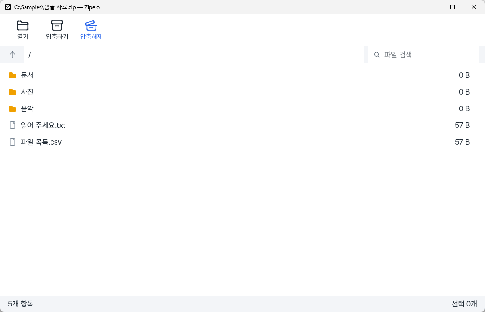

# Zipelo

쉽고 빠른 압축과 압축 해제를 목표로 만드는 MIT 오픈소스 프로그램입니다.

버튼을 누르면 Windows 설치 파일(v0.1.0)을 바로 받습니다. Ubuntu용은 [.deb 설치 파일](https://github.com/Team-LJY/zipelo/releases/download/v0.1.0/zipelo_0.1.0_amd64.deb)을 받으세요. 모든 버전은 [릴리스 페이지](https://github.com/Team-LJY/zipelo/releases/latest)에 있습니다.

## 이런 걸 할 수 있어요

아래 사용 안내는 다운로드로 제공하는 v0.1.0 기준입니다.

- **압축 풀기:** [열기]로 압축 파일을 고르거나 창에 끌어 놓으세요. [압축해제]를 누르고 저장할 곳을 고르면 됩니다. 원하는 파일과 폴더만 선택해서 풀 수도 있습니다.
- **ZIP 만들기:** [압축하기]를 눌러 묶을 폴더를 고른 뒤, ZIP 만들기 창에서 [압축하기]를 누르고 저장할 이름과 위치를 정하세요.
- **암호로 보호하기:** ZIP을 만들 때 [암호로 보호하기]를 켜면 암호를 설정할 수 있습니다. 암호가 걸린 ZIP을 풀 때는 암호를 입력합니다.
- **여러 형식 열기:** ZIP, 7z, TAR, GZ, TAR.GZ를 풀 수 있습니다. 새로 만드는 압축 파일은 ZIP입니다.
- **기본 프로그램 설정:** 설치 마지막 화면에서 [적용]을 누르면 Windows 설정이 열립니다. 사용할 압축 파일 형식의 기본 앱을 Zipelo로 직접 선택하세요.

## 설치 방법

Windows에서는 아래 순서로 설치합니다.

1. 위 다운로드 버튼을 눌러 Windows 설치 파일(`.exe`)을 받으세요.
2. 받은 설치 파일을 더블클릭하고 화면 안내에 따라 설치하세요. "Windows의 PC 보호" 창이 뜨면 [추가 정보]를 누른 뒤 [실행]을 누르세요. 아직 코드 서명이 없는 설치 파일이라 이 창이 나올 수 있습니다.
3. 기본 압축 프로그램으로 쓰려면 마지막 화면에서 [적용]을 누르고 Windows 설정에서 Zipelo를 선택하세요. 설정을 바꾸지 않으려면 [마침]을 누르세요.
4. Zipelo를 실행하고 [열기]에서 압축 파일을 고르세요. 기본 앱으로 설정했다면 압축 파일을 더블클릭해 열 수도 있습니다.

Ubuntu에서는 [.deb 설치 파일](https://github.com/Team-LJY/zipelo/releases/download/v0.1.0/zipelo_0.1.0_amd64.deb)을 받아 `sudo apt install ./zipelo_0.1.0_amd64.deb`로 설치하세요. 처음 설치할 때 ZIP, 7z, TAR, GZ, TAR.GZ의 기본 앱이 Zipelo로 바뀝니다.

## v0.1.0에서 아직 안 되는 것과 사용 전 알아둘 점

- RAR 열기, 손상된 압축 파일 복구, 파일 내용 미리보기는 지원하지 않습니다.
- 여러 조각으로 나뉜 압축 파일과 7z 만들기는 지원하지 않습니다. TAR.BZ2와 TAR.XZ 풀기는 개발 중인 main에서 해결됐으며([PR119](https://github.com/Team-LJY/zipelo/pull/119)), 게시된 v0.1.0에는 포함되지 않습니다. Wayland 파일 선택 창과 릴리스 설치 패키지 검증은 남아 있습니다.
- 한 번에 푸는 파일의 전체 크기와 ZIP으로 묶는 원본의 전체 크기는 각각 16 GiB까지입니다.
- Zipelo에서 암호를 걸어 만든 ZIP은 Windows 탐색기의 기본 압축 기능으로 열 수 없습니다. Zipelo나 7-Zip을 사용하세요. 암호를 잊으면 파일을 열 수 없습니다.
- 같은 이름의 파일을 덮어쓰지 않습니다. 이름이 겹치면 다른 저장 위치나 이름을 선택하세요.
- 현재 배포된 v0.1.0 설치 파일은 기존 버전을 먼저 제거해야 합니다. 다음 버전의 Windows 설치 파일은 기존 위치에 업데이트하며 기본 앱 연결을 유지합니다. 업데이트 준비 화면에서 취소하면 기존 설치가 유지됩니다.
- Windows와 Ubuntu 모두 Zipelo를 제거해도 압축 파일의 기본 앱 설정은 남습니다. Windows에서 파일을 열 때 "앱 선택" 창이 뜨면 다른 앱을 고르거나 설정의 [기본 앱]에서 다시 지정하세요. Ubuntu에서도 다른 압축 앱을 기본 앱으로 다시 선택하세요.

자세한 지원 범위와 제한은 [v0.1 릴리스 노트](docs/release-notes-v0.1.md)를 참고하세요.

## 개발 중인 main에서 해결된 항목

아래 변경은 소스에 반영됐지만 위에서 받는 v0.1.0 설치 파일에는 포함되지 않습니다.

- **파일 내용 미리보기:** 파일 하나를 고른 뒤 [미리보기]를 눌러 UTF-8 텍스트와 정적 PNG/JPEG를 읽기 전용으로 봅니다. 텍스트는 1 MiB, 이미지 파일은 8 MiB까지이며 이미지 가로와 세로는 각각 8,192픽셀, 전체는 1,600만 픽셀까지입니다([PR125](https://github.com/Team-LJY/zipelo/pull/125)).
- **분할 7z 풀기:** 모든 조각을 같은 폴더에 모으고 `.7z.001`을 열면 목록 보기와 풀기를 할 수 있습니다. 조각은 최대 999개이며 분할 파일의 미리보기와 분할 압축 만들기는 지원하지 않습니다([PR126](https://github.com/Team-LJY/zipelo/pull/126)).
- **7z 만들기:** 만들기 화면에서 ZIP 또는 7z를 선택합니다. 7z는 LZMA2 방식으로 만들며 암호를 설정하려면 ZIP을 선택하세요([PR127](https://github.com/Team-LJY/zipelo/pull/127)).
- **손상 ZIP 복구:** 4 GiB 이하 단일 ZIP32의 검증 가능한 비암호화 Store/Deflate 항목을 별도 ZIP으로 저장합니다. 원본은 고치지 않으며 일부만 복구되거나 복구할 수 없는 파일도 있습니다([PR128](https://github.com/Team-LJY/zipelo/pull/128)).
- **같은 이름의 파일 처리:** 덮어쓰기, 건너뛰기, 이름 바꿔 저장을 선택하고 나머지 파일에도 적용할 수 있습니다([PR114](https://github.com/Team-LJY/zipelo/pull/114)).
- **제거 후 기본 앱 정리:** Windows에서는 다른 앱을 선택할 설정 화면을 안내합니다. Ubuntu에서는 같은 사용자가 제거하고 기본 앱이 여전히 Zipelo인 경우, 기록된 이전 앱이 유효하면 복원합니다. 설치 후 사용자가 바꾼 선택은 보존합니다([PR116](https://github.com/Team-LJY/zipelo/pull/116)).
- **큰 작업 허용과 압축 폭탄 대응:** 기본 16 GiB를 넘는 작업은 사용자 허용 후 최대 64 GiB까지 진행할 수 있습니다. 항목 수, 압축률, 진행 시간과 여유 공간 등 안전 제한은 계속 적용됩니다([PR121](https://github.com/Team-LJY/zipelo/pull/121)).
- **Ubuntu X11 실행에 필요한 구성 요소:** 새 `.deb`는 빠져 있던 라이브러리를 설치 의존성에 포함해 X11 시작 오류를 해결했습니다([PR122](https://github.com/Team-LJY/zipelo/pull/122)).

**남은 한계:** 압축된 TAR(TAR.GZ, TAR.BZ2, TAR.XZ)은 기본 16 GiB, 승인 후 요청한 상한(최대 64 GiB)을 따릅니다. 이때 파일 내용뿐 아니라 TAR 헤더와 패딩도 계산하므로 파일 크기 합계보다 먼저 한도에 도달할 수 있습니다. RAR 압축과 해제, 암호화 7z의 생성과 해제, solid 방식의 7z 만들기, 분할 ZIP, 분할 압축 만들기와 분할 파일 미리보기는 지원하지 않습니다. ZIP 복구는 4 GiB 초과, ZIP64, 분할, SFX와 암호화된 내용 등을 지원하지 않으며 모든 손상을 복구하지는 못합니다.

main `3a77cfd`는 Windows 11 Pro build 26300과 Ubuntu 26.04.1 Wayland/X11에서 네 새 기능, 잘못된 암호 재시도와 덮어 설치를 확인했습니다. 실패 시 출력 정리 보강(PR130)은 아직 미완료입니다. 사용자 요청에 따라 v0.2는 로컬 빌드만 허용됐으며 게시하지 않습니다. 구현 범위와 미검증 항목은 [v0.2 릴리스 노트 초안](docs/release-notes-v0.2.md)을 참고하세요.

## 개발자용

Rust로 개발하며 압축 처리는 별도 작업자 프로세스에서 수행합니다. 로컬 빌드와 시험은 `python3 tests/ci/run_rust.py local`로 실행합니다. 프로젝트 이동 뒤 긴 경로 때문에 시험 실행기가 멈추던 문제는 main에서 해결됐습니다([PR118](https://github.com/Team-LJY/zipelo/pull/118)). 새 실제 경로에서 별칭이나 경로 매핑 없이 전체 local 검증을 통과한 기록이 있습니다.

[기획서](docs/PLANS.md)와 [UI 설계](docs/ui-design-v0.1.md)를 참고하세요. 소스는 [MIT 라이선스](LICENSE)로 공개합니다.
