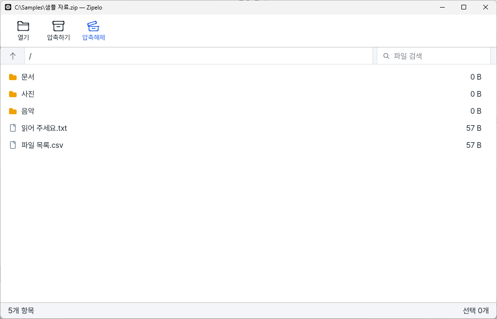

# Zipelo

쉽고 빠른 압축과 압축 해제를 목표로 만드는 MIT 오픈소스 프로그램입니다.

버튼을 누르면 Windows 설치 파일(v0.2.1)을 바로 받습니다. Ubuntu용은 [.deb 설치 파일](https://github.com/Team-LJY/zipelo/releases/download/v0.2.1/zipelo_0.2.1_amd64.deb)을 받으세요. 모든 버전은 [릴리스 페이지](https://github.com/Team-LJY/zipelo/releases/latest)에 있습니다.

## 이런 걸 할 수 있어요

- **압축 풀기:** [열기]로 압축 파일을 고르거나 창에 끌어 놓으세요. [압축해제]를 누르고 저장할 곳을 고르면 됩니다. 원하는 파일과 폴더만 골라서 풀 수도 있고, 오른쪽 클릭 메뉴로 "압축 파일명으로 새 폴더를 만들어 압축 풀기"나 "특정 폴더에 압축 풀기"를 고를 수도 있습니다.
- **끌어서 풀기:** 목록에서 고른 파일과 폴더를 창 밖으로 끌어 파일 관리자나 브라우저의 파일 올리기 영역에 놓으면 그 자리에 풀립니다. 큰 항목은 다 풀린 뒤에 넘어가며, 끄는 도중 Esc를 누르면 취소됩니다.
- **파일 바로 열기와 미리보기:** 목록의 파일을 두 번 누르거나 Enter를 누르면 기본 프로그램으로 엽니다. 실행 파일은 열지 않습니다. [미리보기]를 누르면 텍스트와 PNG/JPEG 그림을 풀지 않고 봅니다.
- **찾기:** Ctrl+F는 지금 폴더 아래에서 이름으로, Ctrl+Shift+F는 압축 파일 전체에서 찾습니다. 결과를 두 번 누르거나 Enter를 누르면 그 위치로 이동합니다. Esc는 떠 있는 창을 닫고, 창이 없으면 프로그램을 끝냅니다.
- **ZIP과 7z 만들기:** [압축하기]를 눌러 묶을 폴더를 고른 뒤 ZIP 또는 7z를 고르세요. ZIP은 [암호로 보호하기]로 암호를 걸 수 있고, 7z는 [쪼갤 용량 설정]으로 `이름.7z.001`, `이름.7z.002`처럼 나눠 저장할 수 있습니다.
- **여러 형식 열기:** ZIP, 7z(나뉜 7z와 암호 7z 포함), TAR, GZ, TAR.GZ, TAR.BZ2, TAR.XZ를 풀 수 있습니다. 나뉜 7z는 모든 조각을 같은 폴더에 두고 `.7z.001`을 여세요.
- **손상된 ZIP 복구:** 망가진 ZIP에서 확인할 수 있는 파일만 골라 새 ZIP으로 저장합니다. 원본은 고치지 않습니다.
- **같은 이름 파일 처리:** 풀 곳에 같은 이름이 있으면 덮어쓰기, 건너뛰기, 이름 바꿔 저장 중에 고를 수 있습니다.
- **큰 작업:** 16 GiB가 넘는 작업은 허용을 물은 뒤 처리합니다. 압축 풀기는 64 GiB까지이고, ZIP과 7z 만들기는 총량 제한 없이 디스크 여유 공간만큼 처리합니다.
- **기본 프로그램 설정:** 설치 마지막 화면에서 [적용]을 누르면 Windows 설정이 열립니다. 사용할 압축 파일 형식의 기본 앱을 Zipelo로 직접 선택하세요.

## 설치 방법

Windows에서는 아래 순서로 설치합니다.

1. 위 다운로드 버튼을 눌러 Windows 설치 파일(`.exe`)을 받으세요.
2. 받은 설치 파일을 더블클릭하고 화면 안내에 따라 설치하세요. "Windows의 PC 보호" 창이 뜨면 [추가 정보]를 누른 뒤 [실행]을 누르세요. 아직 코드 서명이 없는 설치 파일이라 이 창이 나올 수 있습니다.
3. 기본 압축 프로그램으로 쓰려면 마지막 화면에서 [적용]을 누르고 Windows 설정에서 Zipelo를 선택하세요. 설정을 바꾸지 않으려면 [마침]을 누르세요.
4. Zipelo를 실행하고 [열기]에서 압축 파일을 고르세요. 기본 앱으로 설정했다면 압축 파일을 더블클릭해 열 수도 있습니다.

v0.1.0을 쓰고 있다면 제거하지 않고 새 설치 파일을 실행하면 됩니다. 기존 위치에 업데이트하며 기본 앱 연결도 유지합니다.

Ubuntu에서는 [.deb 설치 파일](https://github.com/Team-LJY/zipelo/releases/download/v0.2.1/zipelo_0.2.1_amd64.deb)을 받아 `sudo apt install ./zipelo_0.2.1_amd64.deb`로 설치하세요. 필요한 구성 요소도 함께 설치되고, 이전 버전은 그대로 업데이트됩니다. 처음 설치할 때 ZIP, 7z, TAR, GZ, TAR.GZ의 기본 앱이 Zipelo로 바뀝니다.

## 아직 안 되는 것과 사용 전 알아둘 점

- RAR 파일은 열거나 만들 수 없습니다.
- 암호 7z 만들기, 나뉜 ZIP(`.zip.001`, `.z01`) 열기와 만들기, 나뉜 압축 파일의 미리보기는 지원하지 않습니다. 나눠서 만들기는 7z로만 됩니다.
- ZIP 복구는 4 GiB 이하 ZIP만 다루며 모든 손상을 고치지는 못합니다. 원본은 지우지 말고 복구본 내용을 확인하세요.
- 미리보기는 텍스트(UTF-8)와 PNG/JPEG 그림만 됩니다. 텍스트는 1 MiB, 그림 파일은 8 MiB까지입니다.
- 끌어서 풀기와 파일 바로 열기는 압축 파일 옆 임시 폴더에 먼저 풀고, Zipelo를 닫을 때 지웁니다. 압축 파일이 있는 폴더에 쓸 공간과 권한이 필요합니다.
- Zipelo에서 암호를 걸어 만든 ZIP은 Windows 탐색기의 기본 압축 기능으로 열 수 없습니다. Zipelo나 7-Zip을 사용하세요. 암호를 잊으면 파일을 열 수 없습니다.
- Windows에서 Zipelo를 제거해도 압축 파일의 기본 앱 설정은 남습니다. 제거할 때 안내에 따라 다른 앱을 고르거나 설정의 [기본 앱]에서 다시 지정하세요. Ubuntu는 설치한 사용자가 제거하고 그동안 기본 앱을 바꾸지 않았다면 이전에 쓰던 압축 앱으로 되돌립니다. 이전 앱을 찾지 못하면 직접 다시 선택하세요.
- 설치 파일에는 코드 서명이 없습니다.

자세한 지원 범위와 제한은 [v0.2.1 릴리스 노트](docs/release-notes-v0.2.md)를 참고하세요. 지난 버전은 [v0.1 릴리스 노트](docs/release-notes-v0.1.md)에 있습니다.

## 개발자용

Rust로 개발하며 압축 처리는 별도 작업자 프로세스에서 수행합니다. 로컬 빌드와 시험은 `python3 tests/ci/run_rust.py local`로 실행합니다. 문제를 조사할 때는 `ZIPELO_LOG=debug zipelo`처럼 `ZIPELO_LOG`(off, error, warn, info, debug, trace)로 로그 단계를 바꿀 수 있습니다. 암호는 어느 단계에서도 남기지 않습니다.

[기획서](docs/PLANS.md)와 [UI 설계](docs/ui-design-v0.1.md)를 참고하세요. 소스는 [MIT 라이선스](LICENSE)로 공개합니다.
